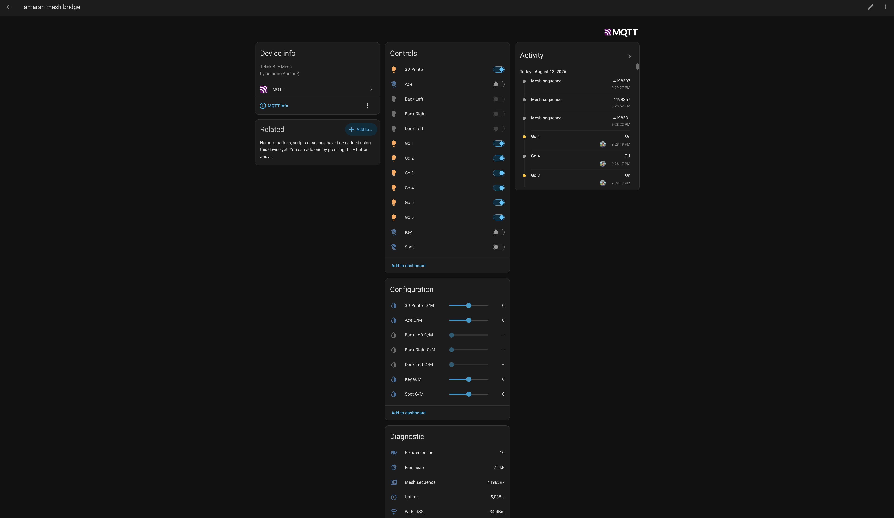

[](https://kevinschaich.com/project/amaran-bridge/)

# amaran-bridge

Control Amaran lights from Home Assistant, no app needed

## How it works

An ESP32-C5 joins your Amaran lights' Bluetooth mesh directly, so nothing depends on the amaran desktop or
mobile app running. It exposes every fixture to Home Assistant over MQTT:

- On/off, brightness, colour temperature, hue/saturation and green/magenta tint
- State read back from the fixtures, so Home Assistant stays in sync after reboots and app changes
- Auto-discovery in Home Assistant, plus live diagnostics



Thanks to [@wesbos](https://github.com/wesbos) and Claude for figuring out the BLE mesh protocol
([amaran-BLE-control](https://github.com/wesbos/amaran-BLE-control)).

## Run locally

Needs an ESP32-C5 devkit, ESP-IDF v5.5.2+, an MQTT broker, and the amaran desktop app paired with your lights once.

```bash
cp main/config.h.example main/config.h   # wifi + mqtt credentials, then edit
python3 tools/gen_mesh_config.py         # mesh keys + fixtures, from the app
python3 patches/apply-net-hook.py ~/esp/esp-idf
./flash.sh
```

The [full guide](docs/GUIDE.md) covers the required ESP-IDF patch, Home Assistant topics, diagnostics,
gotchas and the code layout.
